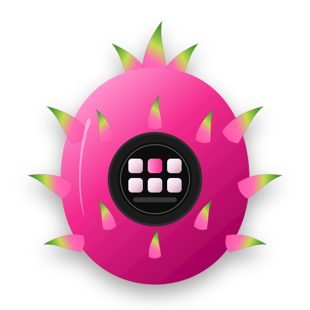

<h2 align="center"><u>Pitaya Deck</u></h2>


<p align="center">
  
</p>
<h4 align="center"> Telefon, tablet albo dowolna przeglądarka jako panel przycisków do komputera </h4>

<p align="center">
    
    
    
<br>
    
    
    
</p>

### [+] Opis
Pitaya Deck zamienia telefon, tablet albo dowolną przeglądarkę w panel przycisków do komputera — jak Stream Deck, ale bez dodatkowego sprzętu. Część rodziny aplikacji **Pitayas**, działa na Linuxie i Windowsie.

### [+] Instalacja
Pobierz najnowszą wersję z [Releases](https://github.com/Pitayas-Team/Pitayas-Deck/releases):
- **Windows:** `PitayaDeck-…-Setup.exe` (instalator) albo `PitayaDeck-…-Portable.exe` (bez instalacji)
- **Fedora / Nobara:** `.rpm` — otwórz plik albo `sudo dnf install ./plik.rpm`
- **Każdy Linux:** `.AppImage` — `chmod +x` i uruchom

Na telefonie nic nie instalujesz: zeskanuj kod QR z aplikacji na komputerze.

### [+] Co potrafi
- **Bez dodatkowej aplikacji na telefonie** — zeskanuj kod QR, zatwierdź urządzenie na komputerze i gotowe. „Dodaj do ekranu głównego” otwiera deck jak aplikację na pełnym ekranie.
- **Edytor jak w Macro Deck 3** — strony Deck, Skrypty, Automatyzacje, Zmienne, Integracje, Biblioteka, Sklep, Urządzenia i Ustawienia; panel folderów chowa się na bok, edytor wraca do ostatnio otwartego miejsca.
- **Profile i foldery** — dowolny rozmiar siatki (do 16×12), zagnieżdżone foldery, ulubione foldery, każde urządzenie może mieć inny profil.
- **Widżety** — przycisk akcji, folder, suwak (głośność, mikrofon, Spotify, własna zmienna), zegar, odtwarzacz muzyki z okładką, wskaźniki CPU / GPU / RAM, odliczanie, stoper, pogoda. Okno wyboru widżetu pokazuje podgląd na żywo.
- **Wygląd** — ikony Lucide (ponad 2000, wyszukiwanie po polsku), emoji albo własne obrazy, wybór koloru z polem barw i ostatnio użytymi kolorami, napisy ze zmiennymi (`CPU {system.cpu}%`), obramowanie, wiele stanów przycisku z innym wyglądem.
- **Akcje jako bloki** — Jeśli / W przeciwnym razie, Przełącznik, Powtórz, Dopóki, Czekaj, Przerwij, Zatrzymaj; komentarze, wyłączanie, kopiuj / wytnij / wklej, przeciąganie. Wyzwalacze: krótkie i długie naciśnięcie, podwójne dotknięcie, początek i koniec dotyku, zmiana wartości suwaka, zmiana stanu.
- **Skrypty** — te same akcje w wielu przyciskach (akcja „Uruchom skrypt”).
- **Automatyzacje** — akcje bez dotykania przycisku: o godzinie, gdy zmienna spełni warunek, przy jej zmianie, co jakiś czas albo po starcie.
- **Tryb testu** — „Testuj klikając” naciska przyciski prosto w edytorze (także foldery i przytrzymanie).
- **Tryb JSON** — każdy widżet można edytować jako JSON.
- **Sklep z dodatkami** — instalacja i aktualizacja bez restartu, ulubione akcje i widżety, możliwość podpięcia własnego katalogu dodatków.
- **Import z Macro Deck** — foldery, przyciski, stany, suwaki, wskaźniki, odtwarzacz i ikony jednym kliknięciem (*Ustawienia → Przenieś deck z Macro Deck*).
- **Panel w przeglądarce** — ten sam edytor z innego komputera w sieci pod adresem `http://<ip decka>:8191/admin`. Domyślnie wyłączony; włączasz go i ustawiasz hasło w *Ustawienia → Panel w przeglądarce* (tylko w aplikacji na komputerze).
- **Własne wtyczki** — w `~/.config/Pitayas/Deck/data/plugins`, instrukcja w [docs/WTYCZKI.md](docs/WTYCZKI.md).

### [+] Wbudowane wtyczki
| Wtyczka | Akcje |
| --- | --- |
| **Deck** | otwórz folder, wstecz, ekran startowy, przełącz profil, ustaw / przełącz / zwiększ zmienną, stan przycisku, uruchom skrypt, czekaj, komunikat na urządzeniu |
| **System** | skrót klawiszowy, wpisz tekst (z polskimi znakami), otwórz program / plik / link, uruchom polecenie, zablokuj ekran, powiadomienie |
| **Muzyka i dźwięk** | graj / pauza / następny / poprzedni (Spotify, przeglądarka, VLC…), playlisty, losowo, powtarzanie, głośność systemu i odtwarzacza, mikrofon |
| **Soundboard** | odtwórz dźwięk, zatrzymaj dźwięki |
| **Internet i dom** | zapytanie HTTP / webhook, Home Assistant |

### [+] Dodatki w sklepie
| Dodatek | Co dodaje |
| --- | --- |
| **Spotify** | graj / pauza, playlisty (z listy albo z linku), polubienia, losowo, powtarzanie, głośność, przełączanie urządzeń, top utwory; działa bez logowania, logowanie (własna aplikacja Spotify) dodaje więcej |
| **Discord** | wycisz mikrofon, wyłącz dźwięk, głośności, tryb mówienia, tłumienie szumów, dołącz / opuść kanał; pełne sterowanie przez Discord RPC (własna aplikacja Discord), bez niej przez skróty |
| **OBS Studio** | sceny, transmisja, nagrywanie, powtórka, źródła, wirtualna kamera |
| **Home Assistant** | włącz / wyłącz urządzenia, jasność świateł, sceny i skrypty, dowolna usługa, stan encji jako zmienne |
| **Minutnik** | odliczanie, stoper, pomodoro |
| **Pogoda** | temperatura i prognoza (Open-Meteo, bez klucza) |
| **Słuchawki Arctis** *(Linux)* | ANC / Transparency, mikrofon, sidetone, korektor, bateria — przez Pitaya Gear |
| **Mysz G502** *(Linux)* | DPI, profile, kolor podświetlenia — przez Pitaya Gear |
| **Klawiatura RGB** *(Linux)* | kolor i jasność klawiatury laptopa GIGABYTE — przez Pitaya Gear |
| **Wentylatory GIGABYTE** *(Linux)* | tryby, Turbo, temperatury, limit baterii — przez Pitaya Gear |

### [+] Wymagania
- Linux (Wayland albo X11) lub Windows. Telefon w tej samej sieci co komputer (albo w tej samej sieci Tailscale).
- **Skróty klawiszowe na Linuxie:** Pitaya Deck tworzy wirtualną klawiaturę przez `/dev/uinput` (działa wszędzie, także na Waylandzie). Gdy nie ma do niego dostępu, używa `ydotool`, `xdotool` albo `wtype`. Stan widać w *Ustawienia → Klawiatura*. Na Windowsie skróty działają przez wbudowane funkcje systemu.
- **Odtwarzacze (Linux):** sterowanie przez MPRIS (D-Bus), głośność przez PipeWire (`wpctl`) albo PulseAudio (`pactl`). Na Windowsie część funkcji muzyki działa przez klawisze multimedialne.
- **OBS:** OBS 28+ → *Narzędzia → Ustawienia serwera WebSocket* → włącz serwer i wpisz hasło w ustawieniach wtyczki.

### [+] Dane
Profile, przyciski, obrazy i ustawienia są w `~/.config/Pitayas/Deck/` (Windows: `%APPDATA%\Pitayas\Deck`) — wspólny folder aplikacji Pitayas (Pitaya Core). Kopię zapasową zrobisz w *Ustawienia → Kopia zapasowa → Eksportuj deck*.

### [+] Uruchomienie ze źródeł
```bash
npm install
npm start
```

### [+] Licencja
MIT. Pitaya Deck jest napisany od zera — nie zawiera kodu, ikon ani materiałów innych programów tego typu.
